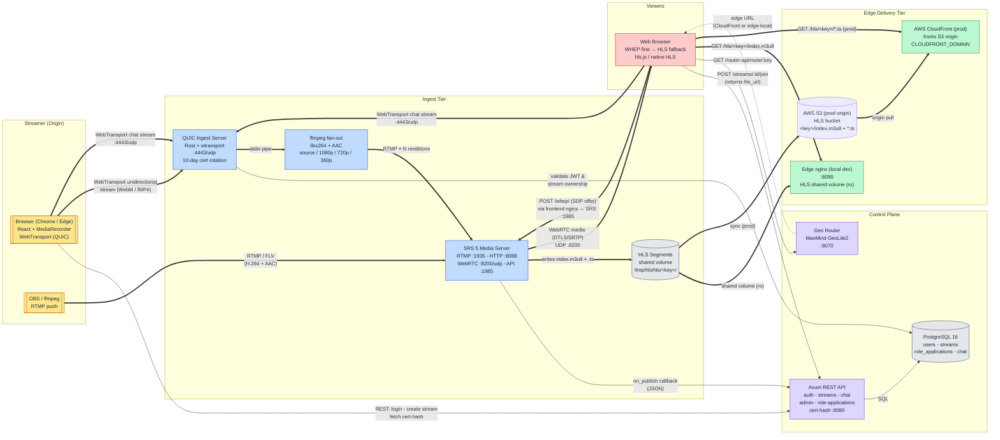
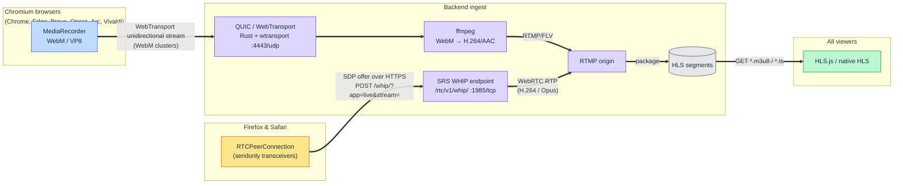
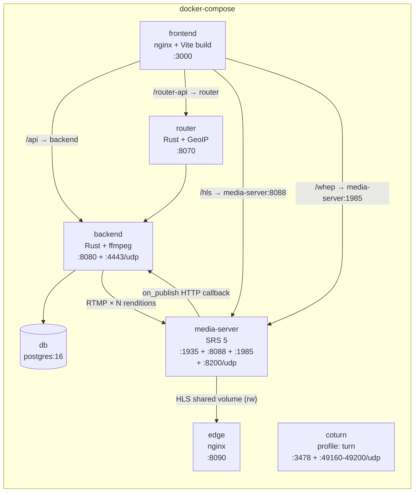
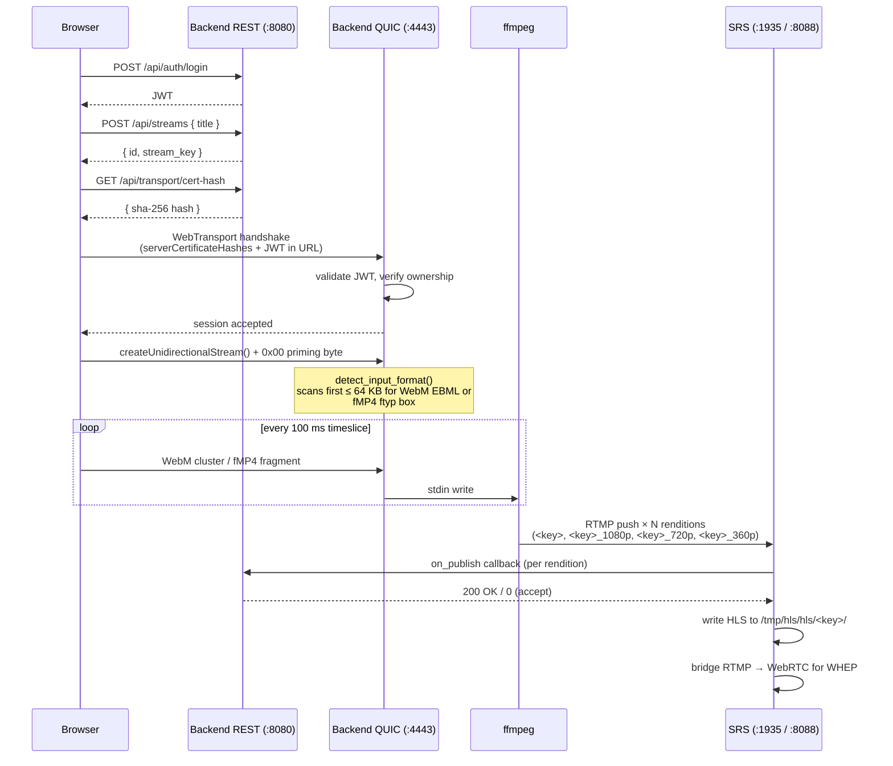
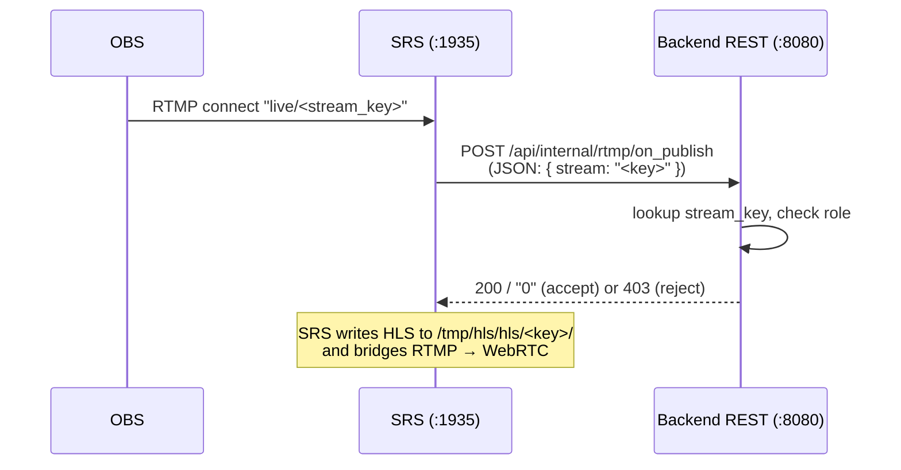
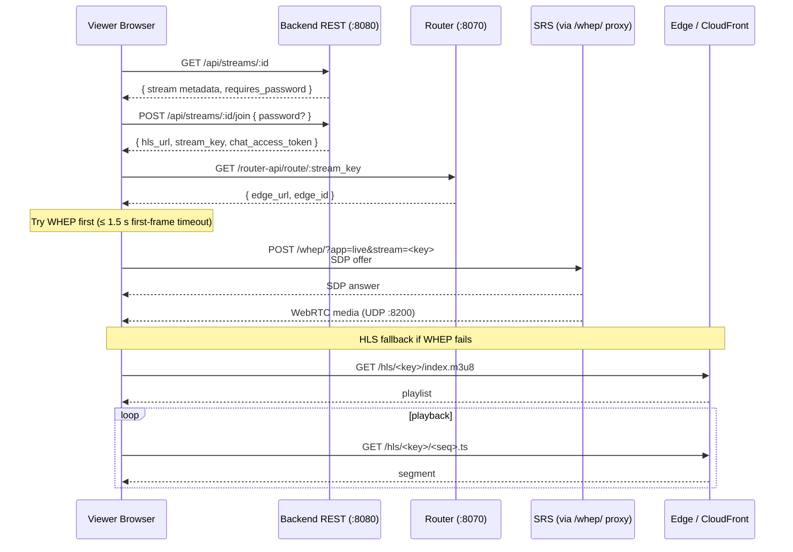
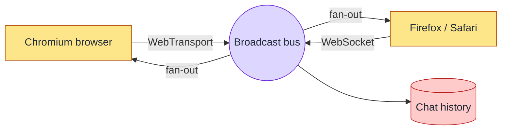

# Architecture

This document describes the Fidget streaming platform as it actually
ships today. For a higher-level prose tour with the team status table,
see [TEAMREADME.md](../TEAMREADME.md).

## End-to-End Streaming Pipeline

Two ingest paths coexist:

- **Browser publish (WebTransport)** — Chromium browsers (Chrome,
  Edge, Brave, Opera, Arc, Vivaldi) open a WebTransport (QUIC) session
  to the Rust backend, which runs ffmpeg to fan the stream out to
  multiple RTMP renditions in a single decode pass.
- **Browser publish (WHIP)** — Firefox, Safari, and any deployment
  where the WebTransport UDP path is unreachable (e.g. behind a CDN
  that can't proxy UDP) post an SDP offer to SRS's WHIP endpoint. SRS
  bridges the WebRTC publish into RTMP, the backend's `on_publish`
  callback fires, and a supervised ffmpeg "WHIP rendition ladder"
  pulls the bridged RTMP source and pushes derived 720p / 360p RTMP
  outputs back to SRS. The bare publish key serves as the "Source"
  tier (no extra encode), keeping the WHIP path lean.
- **OBS publish** — any RTMP encoder (OBS, ffmpeg, etc.) pushes
  directly to the SRS media server.

Viewers connect via **WHEP (WebRTC) first** for sub-second playback,
falling back to HLS when WebRTC fails (corporate firewalls, missing
TURN, etc.). The first-frame timeout is **1.5 s** so a blocked UDP
path (e.g. EC2 security group missing UDP 8000) doesn't leave the
viewer staring at a black player before HLS takes over.

**Legend**

- **Thick solid arrows (`==>`)** — hot media path (video / audio bytes).
- **Thin solid arrows (`-->`)** — synchronous control / REST calls.
- **Dotted arrows (`-.->`)** — asynchronous responses or telemetry.
- Colors group nodes by tier: origin, ingest, control plane, edge, clients,
  and persistent storage.

## Browser-Specific Ingest Pipelines

Not every browser ships [WebTransport](https://www.w3.org/TR/webtransport/),
so the streamer client picks an ingest transport at runtime. Chromium-based
browsers (Chrome, Edge, Brave, Opera, Arc, Vivaldi) take the WebTransport
path; Firefox and Safari fall back to **WHIP** (WebRTC-HTTP Ingestion
Protocol, [RFC 9725](https://datatracker.ietf.org/doc/html/rfc9725)),
which SRS terminates and bridges into the same RTMP → HLS pipeline. Viewers
are unaffected — both forks converge on identical HLS output.

**Transport selection logic** (in [`ScreenCapture.jsx`](../frontend/src/components/streamer/ScreenCapture.jsx)):

| Capability check                              | Chosen ingest transport |
|-----------------------------------------------|-------------------------|
| `VITE_DISABLE_WEBTRANSPORT=1` build arg set   | WHIP (forced)           |
| Otherwise `globalThis.WebTransport` available | WebTransport            |
| Otherwise `RTCPeerConnection` is a function   | WHIP / WebRTC fallback  |
| Neither is available                          | UI disables Go Live     |

The `VITE_DISABLE_WEBTRANSPORT` escape hatch (wired through
[`docker-compose.yml`](../docker-compose.yml) →
[`frontend/Dockerfile`](../frontend/Dockerfile)) forces every browser
onto the WHIP path. This is required for deployments behind CDNs that
can't proxy UDP (CloudFront, most managed front-doors), where the
WebTransport UDP/4443 ingest is unreachable from the public internet.

**Same auth model** — the WHIP URL embeds the existing per-stream
`stream_key` (`/whip/?app=live&stream=<key>`), the same secret SRS already
trusts for the RTMP publish path. No JWT plumbing into SRS is required.

**Same downstream path** — SRS bridges the WebRTC RTP into its internal
RTMP origin (gated by `rtc_to_rtmp on` in
[`media-server/srs.conf`](../media-server/srs.conf)), so the HLS
packager, edge cache, and player code are unchanged regardless of which
browser the streamer used.

**Transient ICE handling on the publisher.** The streamer-side
`RTCPeerConnection` only treats `failed` and `closed` as terminal
states. `disconnected` is a transient lifecycle state (W3C WebRTC) —
ICE often recovers within a few seconds, e.g. when a WHEP viewer
refreshing momentarily perturbs SRS's `rtc_to_rtmp` bridge. Combined
with the backend's 3 s `on_publish_done` debounce (see *Browser publish
(WHIP)* above), this means a brief SRS hiccup no longer ends the
broadcast from the streamer's perspective. See
[`frontend/src/components/streamer/ScreenCapture.jsx`](../frontend/src/components/streamer/ScreenCapture.jsx).

**Backend rendition ladder for WHIP** — because the WHIP fork hands SRS
a single SDP-negotiated resolution, the backend supplements the bare
source with a supervised ffmpeg ladder defined in
[`backend/src/transcode.rs`](../backend/src/transcode.rs):

| Rendition | Resolution | Video bitrate | Audio bitrate |
|-----------|------------|---------------|---------------|
| Source    | as published | passthrough (SRS-native HLS) | as published |
| `_720p`   | 1280×720   | 2000 kbps     | 96 kbps       |
| `_360p`   | 640×360    | 600 kbps      | 64 kbps       |

When SRS calls `on_publish` for a non-rendition stream key, the backend
spawns the ladder (1.5 s grace so the `rtc_to_rtmp` bridge has time to
start producing RTMP), and tears it down on `on_publish_done`.
`tokio::process::Child::kill_on_drop(true)` ensures the encoders are
reaped if the supervisor task is aborted.

**Offline debounce.** SRS occasionally fires `on_publish_done` for
transient internal renegotiations — a viewer joining or leaving via
WHEP can churn the `rtc_to_rtmp` bridge, briefly tearing down the
RTMP source even though the publisher is still live. To avoid flipping
the stream offline (and surfacing "stream ended" to the streamer)
every time this happens, `on_publish_done` schedules a **3 s debounced
offline transition**. If a fresh `on_publish` lands inside that
window, the pending task is cancelled (`JoinHandle::abort`) and the
stream stays live from the user's perspective. The pending tasks are
tracked in an `Arc<Mutex<HashMap<Uuid, JoinHandle<()>>>>` injected as
an Axum `Extension` (see `OfflineDebouncer` in
[`backend/src/routes/internal.rs`](../backend/src/routes/internal.rs)).

## Container Layout

## Frontend nginx Proxy Map

The frontend container is plain nginx serving the React build. All
cross-service browser traffic is reverse-proxied through it so the
browser only ever talks to one origin (`http://localhost:3000` in dev,
the public hostname in prod). This avoids CORS preflights and keeps
HTTPS clean in production.

| Browser path        | Proxied to                                | Purpose                              |
|---------------------|-------------------------------------------|--------------------------------------|
| `/`                 | static React SPA                          | UI                                   |
| `/api/`             | `backend:8080`                            | REST: auth, streams, chat, admin     |
| `/router-api/`      | `router:8070/api/`                        | Edge selection (`/route/:key`)       |
| `/hls/`             | `media-server:8088`                       | HLS playlists & TS segments          |
| `/whep/`            | `media-server:1985/rtc/v1/whep/`          | WHEP signalling (SDP exchange)       |

WebTransport ingest (`https://<host>:4443/...`) and the WebRTC media
plane (`UDP :8200`) bypass nginx because they are not HTTP.

## Request Flows

### Browser publish (Chrome / Edge)

Notes:

- The frontend uses a **single ordered unidirectional stream** instead
  of the older datagram-fragment protocol. Datagrams had flaky
  cross-browser support (Firefox in particular silently dropped them);
  ordered streams give us reliable in-order WebM / fMP4 delivery and
  removed an entire reassembly path on the server.
- The 1-byte priming write forces the QUIC `STREAM` frame onto the
  wire immediately so the backend's `accept_uni()` doesn't stall when
  MediaRecorder is slow to emit its first chunk.
- The QUIC server's self-signed certificate is **rotated every 10 days**
  (Chrome's WebTransport spec rejects `serverCertificateHashes` certs
  whose validity period exceeds 14 days). The cert-hash route reads
  from a shared `Arc<RwLock<String>>` so subsequent "Go Live" clicks
  always pin the cert that's currently in force.

### OBS publish

OBS is the recommended publish path for Firefox and Safari users since
neither browser ships WebTransport with `serverCertificateHashes`
enabled by default.

Note that the `on_publish_done` handler does **not** flip the stream
offline immediately — it schedules a 3 s debounced transition (see
*Offline debounce* above) so a transient SRS renegotiation (e.g. a WHEP
viewer churning the `rtc_to_rtmp` bridge) doesn't end the stream from
the user's perspective.

### Viewer: watch a stream

## HLS Path Conventions

SRS writes segments under a nested directory so a single HTTP server
rooted at `/tmp/hls` exposes them at the same URL shape the backend
hands out:

| File                    | On disk                                  | URL                                  |
|-------------------------|------------------------------------------|--------------------------------------|
| Playlist                | `/tmp/hls/hls/<key>/index.m3u8`          | `/hls/<key>/index.m3u8`              |
| Segments                | `/tmp/hls/hls/<key>/<seq>.ts`            | `/hls/<key>/<seq>.ts`                |
| 1080p rendition (WT)    | `/tmp/hls/hls/<key>_1080p/index.m3u8`    | `/hls/<key>_1080p/index.m3u8`        |
| 720p rendition          | `/tmp/hls/hls/<key>_720p/index.m3u8`     | `/hls/<key>_720p/index.m3u8`         |
| 360p rendition          | `/tmp/hls/hls/<key>_360p/index.m3u8`     | `/hls/<key>_360p/index.m3u8`         |

The `_1080p` rendition is only emitted by the WebTransport ingest path
(it uses `-c:v copy` passthrough on H.264/MP4 sources). The WHIP ladder
in `transcode.rs` produces only `_720p` and `_360p`, with the bare
`<key>` playlist serving as the Source tier from SRS-native HLS.

The edge container mounts the same `hls_segments` Docker volume
**read-only** so it can serve segments directly without an extra HTTP
hop to the origin. Production deployments put CloudFront in front of
the edge for global fan-out; the URL shape is identical.

## Encoding Ladder

The encoding ladder differs slightly between the two browser-publish
paths, but converges on the same set of HLS playlist URLs:

### WebTransport path (`backend/src/quic.rs`, `RENDITIONS`)

A single decode pass feeds `-filter_complex split=N` into N encoders
running inside the same ffmpeg process the QUIC server pipes the
browser bitstream into.

| Rendition | Resolution        | Video bitrate              | Audio bitrate |
|-----------|-------------------|----------------------------|---------------|
| `_1080p`  | up to 1920×1080   | passthrough on H.264/MP4, else 4000 kbps | 128 kbps |
| `_720p`   | up to 1280×720    | 2000 kbps                  | 96 kbps       |
| `_360p`   | up to 640×360     | 600 kbps                   | 64 kbps       |

Scale uses `force_original_aspect_ratio=decrease`, so a smaller source
passes through at its native size rather than upscaling.

### WHIP path (`backend/src/transcode.rs`, `WHIP_LADDER`)

The WHIP source already exists as RTMP inside SRS (via the
`rtc_to_rtmp` bridge), so the bare `<key>` HLS playlist serves as the
Source tier without a re-encode. A separate supervised ffmpeg pulls
the RTMP source and pushes the lower tiers back to SRS:

| Rendition | Resolution | Video bitrate | Audio bitrate |
|-----------|------------|---------------|---------------|
| Source    | as published | passthrough | as published  |
| `_720p`   | 1280×720   | 2000 kbps     | 96 kbps       |
| `_360p`   | 640×360    | 600 kbps      | 64 kbps       |

The viewer's "Quality" dropdown selects a rendition by appending the
suffix (`_720p`, `_360p`) to the stream key for both WHEP and HLS
URLs; the `source` option uses the unsuffixed key. There is no
automatic ABR — the user picks.

## Routing Precedence

The geo router resolves the edge URL for a stream key in this order:

1. `EDGE_SERVERS` env (`id,url,lat,lon;...`) → MaxMind Haversine pick.
2. `CLOUDFRONT_DOMAIN` env → single CloudFront edge.
3. Local fallback: `http://edge:8090`.

The same precedence is mirrored in the backend's `join_stream` handler
when it builds the absolute or relative `hls_url` returned to the
viewer.

## Auth, Roles, and Admin Bootstrap

- JWTs are issued by `/api/auth/login` and required for stream creation,
  WebTransport ingest, and chat.
- Roles: `admin`, `streamer`, regular user.
- The admin row is upserted from `ADMIN_USERNAME` / `ADMIN_PASSWORD` env
  vars on every backend boot (`db::ensure_admin_user`), so a new
  deployment ships with a working admin account.
- Regular users can request the `streamer` role through the
  `role_applications` table; admins approve / deny from `/admin`.

## Operational Diagnostics

A few backend log lines exist specifically to make common deployment
failure modes obvious without grepping through SRS logs:

| Startup line                                                  | Meaning                                                              |
|---------------------------------------------------------------|----------------------------------------------------------------------|
| `WebRTC candidate configured candidate=<host>`                | `CANDIDATE` env is set to a routable host — WHIP/WHEP can work.      |
| `CANDIDATE is unset or loopback ...`                          | `CANDIDATE` is empty / `127.0.0.1` / `localhost`. WebRTC will fail for any non-localhost client. Set `CANDIDATE=<public IP>` in `.env` and open UDP 8000. |
| `Scheduled debounced offline transition`                      | `on_publish_done` arrived; offline flip is queued behind a 3 s timer. |
| `Marked stream offline (debounced)`                           | The 3 s timer expired with no re-publish; stream is now offline.     |
| `Spawned WHIP rendition ladder ...`                           | Backend ffmpeg rendition ladder for a WHIP source has started.       |

See [`docs/DEPLOY.md`](./DEPLOY.md) for the full EC2 / S3 / CloudFront
checklist, including the security-group rules that have to be in place
for `CANDIDATE` to actually work.

## Technology Stack

| Layer            | Technology                                          |
|------------------|-----------------------------------------------------|
| Frontend         | React, Vite, hls.js, native WebRTC / WebTransport   |
| REST API         | Rust, Axum, SQLx                                    |
| Browser ingest   | WebTransport unidirectional streams via wtransport  |
| Transcoding      | ffmpeg (libx264, AAC LC), filter_complex split fan-out |
| Media server     | SRS 5 (RTMP, WebRTC bridge, HLS, HTTP API)          |
| Edge delivery    | nginx (HLS), shared Docker volume                   |
| CDN (prod)       | CloudFront (opt-in via `CLOUDFRONT_DOMAIN`)         |
| TURN (optional)  | coturn (`--profile turn`)                           |
| Geo-routing      | Rust, MaxMind GeoLite2                              |
| Database         | PostgreSQL 16                                       |
| Auth             | JWT (`jsonwebtoken` crate) + `bcrypt`               |
| Container runtime| Docker Compose                                      |

## Chat Transport (WebTransport + WebSocket Fallback)

Chat uses the same per-stream broadcast bus on the backend, but the
client picks one of two transports depending on browser capability:

- **WebTransport (`:4443/udp`)** — preferred path on Chromium browsers.
  Reuses the QUIC stack already stood up for video ingest, with a
  dedicated bidirectional stream per chat session and a short-lived
  `chat_access_token` minted by `POST /api/streams/:id/join`.
- **WebSocket fallback (`/api/chat/streams/:id/ws?token=<jwt>`)** —
  used when WebTransport isn't available (Firefox, Safari) or fails to
  connect. The token is passed as a query parameter because browsers
  don't allow custom headers on `new WebSocket(...)`. Both transports
  speak the same line-delimited JSON protocol so the server-side
  broadcast loop is identical.

The frontend tries WebTransport first and silently falls back to the
WebSocket route on any handshake or stream-open failure, so the user
never sees a degraded experience.

## Browser Support Matrix

| Capability                        | Chrome / Edge | Firefox          | Safari          |
|-----------------------------------|---------------|------------------|-----------------|
| Browser publish (WebTransport)    | Yes           | No (pref-gated)  | No              |
| Browser publish (WHIP fallback)   | Yes           | Yes              | Yes             |
| OBS / RTMP publish                | Yes           | Yes              | Yes             |
| Watch via WHEP (WebRTC)           | Yes           | Yes              | Yes             |
| Watch via HLS fallback            | Yes (hls.js)  | Yes (hls.js)     | Yes (native)    |
| Chat (WebTransport)               | Yes           | No (pref-gated)  | No              |
| Chat (WebSocket fallback)         | Yes           | Yes              | Yes             |

The streamer client picks WebTransport when available and WHIP otherwise,
so all four major browsers can broadcast directly from the page. OBS
remains supported as a third option for users who already have an
encoder configured. Chat behaves the same way: WebTransport first,
WebSocket fallback so every viewer can still post messages.
