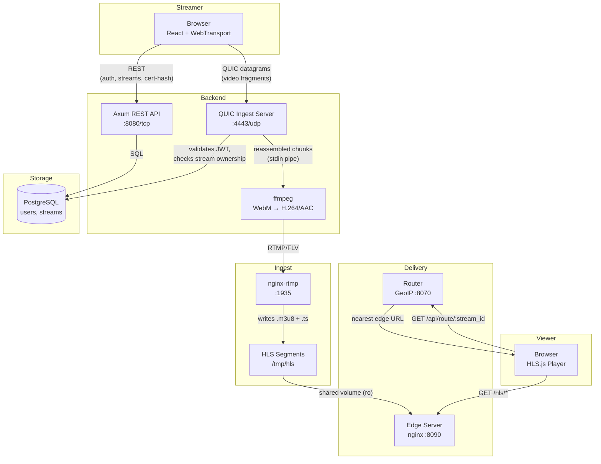
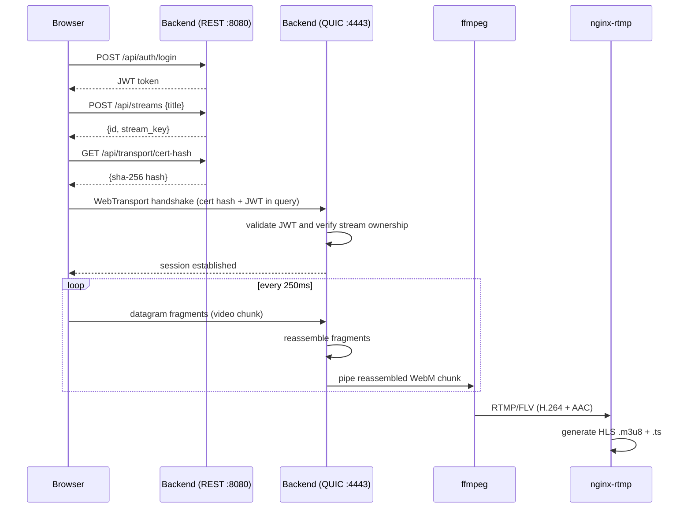
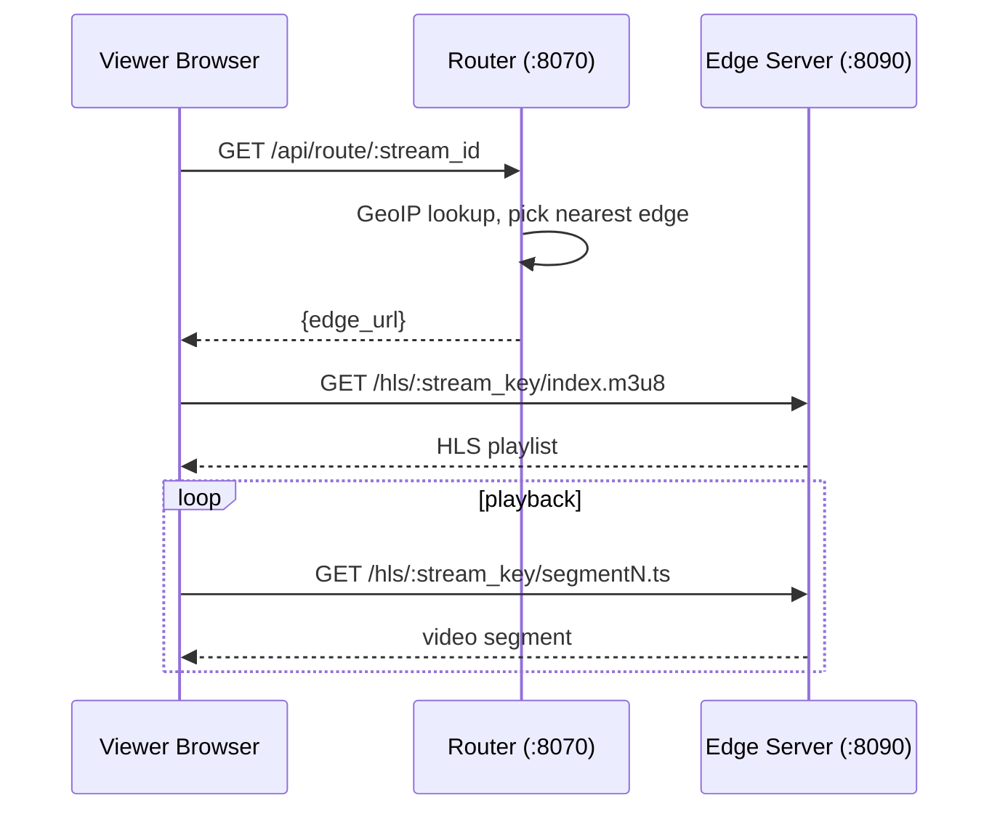
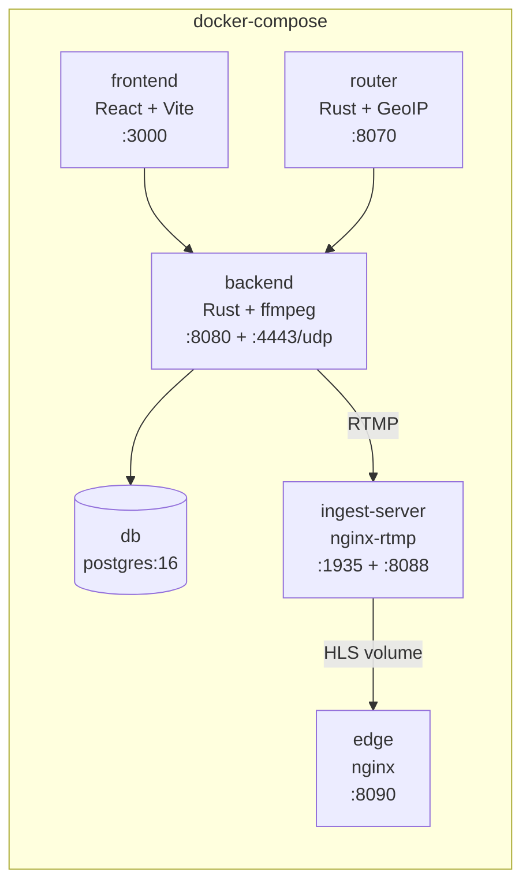
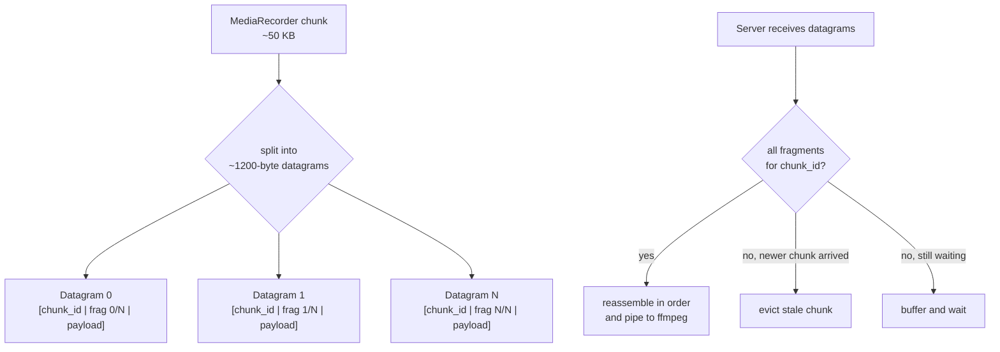

# Architecture

## System Overview

## Request Flows

### Streamer: Go Live

### Viewer: Watch Stream

## Container Layout

## QUIC Datagram Fragment Protocol

Each MediaRecorder chunk (~10–100 KB) is split into QUIC datagrams with an 8-byte header:

## Technology Stack

| Layer | Technology |
|-------|-----------|
| Frontend | React, Vite, HLS.js |
| REST API | Rust, Axum, SQLx |
| Video Ingest | QUIC datagrams via wtransport |
| Transcoding | ffmpeg (WebM → H.264/AAC → RTMP) |
| Media Server | nginx-rtmp (RTMP → HLS) |
| Edge Delivery | nginx (static HLS) |
| Geo-Routing | Rust, MaxMind GeoLite2 |
| Database | PostgreSQL 16 |
| Auth | JWT (jsonwebtoken crate) |
