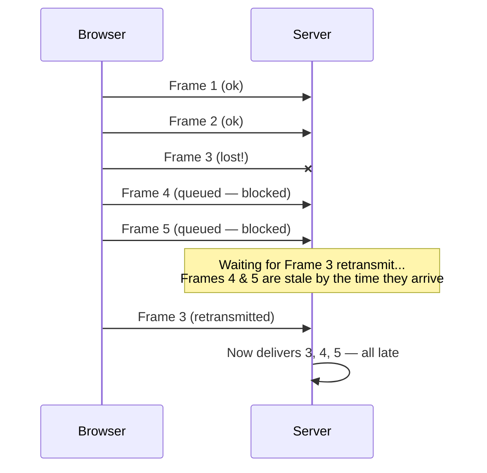
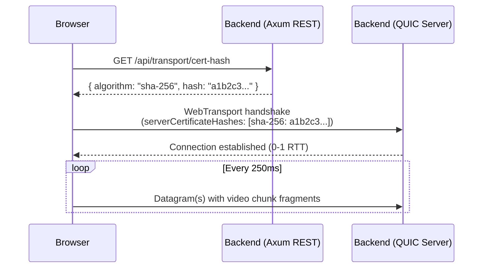
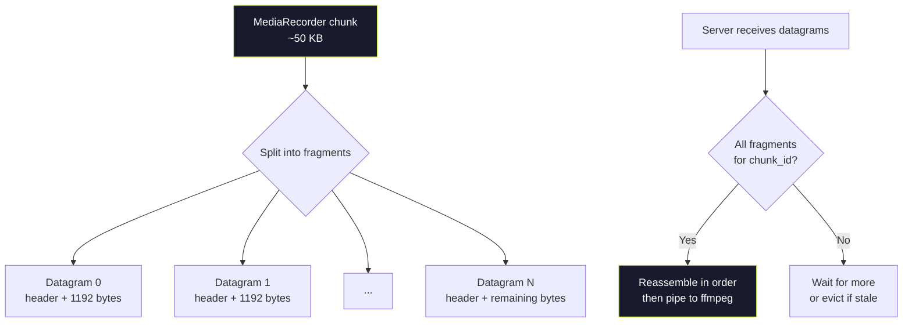
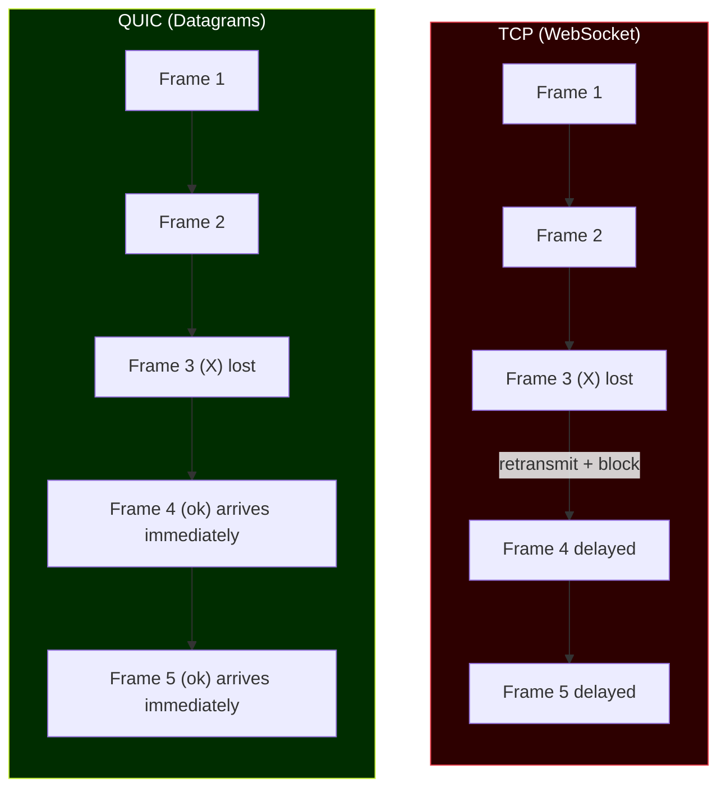

# QUIC Unreliable Datagrams for Live Video Ingest

## Why QUIC instead of TCP?

TCP guarantees in-order, reliable delivery — great for web pages and API calls, terrible for real-time video. When a TCP packet is lost, **every subsequent packet is blocked** until the lost one is retransmitted. This is called **head-of-line (HOL) blocking**, and it causes visible stuttering in live video because fresh frames pile up behind a stale retransmission that viewers don't even care about anymore.

### The problem with TCP for live video



For live streaming, a dropped video frame is **less harmful** than delaying all future frames. The viewer would rather see a brief glitch than a frozen stream.

## QUIC Unreliable Datagrams (RFC 9221)

QUIC is a modern transport protocol built on UDP. While QUIC normally provides reliable, ordered streams (like TCP but without HOL blocking between streams), it also supports an extension called **unreliable datagrams** defined in [RFC 9221](https://datatracker.ietf.org/doc/html/rfc9221).

Unreliable datagrams give us the best of both worlds:

| Property | TCP | QUIC Streams | QUIC Datagrams |
|----------|-----|-------------|----------------|
| Encryption | TLS 1.2/1.3 | TLS 1.3 | TLS 1.3 |
| Ordered delivery | Yes | Yes (per-stream) | No |
| Reliable delivery | Yes | Yes | **No** |
| Head-of-line blocking | Yes | No (between streams) | **No** |
| Congestion control | TCP CC | QUIC CC | QUIC CC |
| Connection setup | 1-2 RTT | **0-1 RTT** | **0-1 RTT** |

Key advantages over raw UDP:
- **Still encrypted** (TLS 1.3) — no plaintext video on the wire
- **Still congestion-controlled** — won't flood the network
- **0-RTT connection setup** — faster than TCP's 3-way handshake + TLS
- **Connection migration** -- survives IP changes (e.g., switching WiFi to cellular)

## How We Use It: WebTransport

[WebTransport](https://www.w3.org/TR/webtransport/) is a browser API that exposes QUIC features — including unreliable datagrams — to JavaScript. It runs over HTTP/3 and is supported in Chrome 97+, Edge 97+, and Firefox 114+.

### Data flow


### Connection establishment

The browser needs to trust the server's self-signed certificate. We solve this by having the backend expose the certificate's SHA-256 hash via a REST endpoint, which the browser fetches before opening the WebTransport session.



## Fragment Protocol

QUIC datagrams have a maximum size (typically ~1,200 bytes). A single MediaRecorder chunk can be 10–100 KB. We split each chunk into **fragments** with an 8-byte header:

```
┌─────────────────────────────────────────────────────────┐
│                   QUIC Datagram                         │
├──────────┬──────────┬──────────┬────────────────────────┤
│ chunk_id │frag_index│frag_total│       payload          │
│  4 bytes │ 2 bytes  │ 2 bytes  │   ≤1,192 bytes        │
│ (u32 BE) │(u16 BE)  │(u16 BE)  │                        │
└──────────┴──────────┴──────────┴────────────────────────┘
```



### Fragment reassembly on the server

The server maintains a `HashMap<chunk_id, fragments>`. When all fragments for a chunk arrive, they are reassembled in order and piped to ffmpeg. Stale incomplete chunks (when newer chunk_ids arrive) are evicted to prevent memory buildup. At most 3 pending chunks are kept in memory.

### Why this is better than TCP for our use case



With QUIC datagrams:
- Lost frames are simply **skipped** — the server uses the next available chunk
- Fresh frames are **never delayed** by stale retransmissions
- The viewer sees a brief glitch instead of a frozen stream

## Implementation Details

### Backend (Rust)

- **Crate:** [`wtransport`](https://crates.io/crates/wtransport) v0.7 with `self-signed` feature
- **Identity:** `Identity::self_signed(["localhost", "127.0.0.1", "::1"])` generates a TLS certificate trusted by the browser via hash pinning
- **Port:** UDP 4443 (configurable via `QUIC_PORT` env var)
- **Auth:** JWT token passed in the WebTransport URL query string, validated before accepting the session

### Frontend (JavaScript)

- **API:** `WebTransport` browser API with `serverCertificateHashes` for self-signed cert trust
- **Fragmentation:** Chunks from `MediaRecorder.ondataavailable` are split into ~1,200-byte datagrams with the fragment header
- **Writer:** `transport.datagrams.writable.getWriter()` for sending datagrams

### Docker

- Backend container exposes `4443/udp` alongside the existing `8080/tcp` for the REST API

## Browser Compatibility

| Browser | WebTransport | Unreliable Datagrams |
|---------|-------------|---------------------|
| Chrome 97+ | Yes | Yes |
| Edge 97+ | Yes | Yes |
| Firefox 114+ | Yes | Yes |
| Safari | No | No |

> **Note:** Safari does not support WebTransport yet. For Safari users, a WebSocket fallback could be added in the future.
