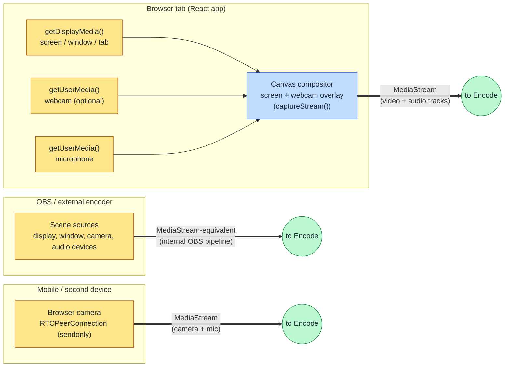
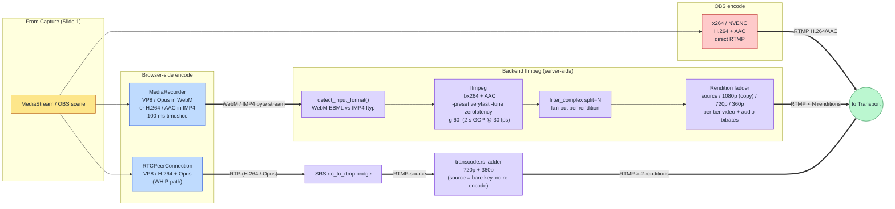
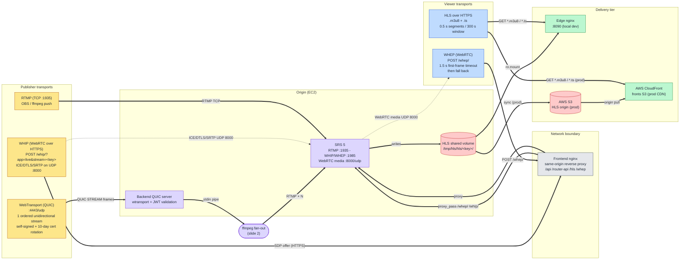
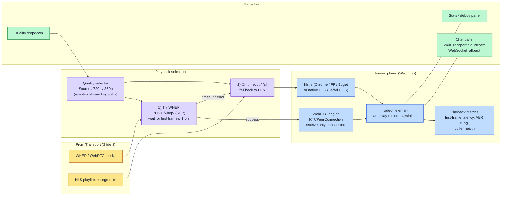

# Slide Diagrams — Capture / Encode / Transport / Display

One diagram per slide, in pipeline order. Each is self-contained
(legend, color key, and short caption) so you can paste a single
mermaid block per slide without context from neighboring diagrams.

All diagrams render natively in GitHub, VS Code, and any Mermaid
Live exporter (mermaid.live → PNG / SVG) for slide decks.

---

## Slide 1 — Capture

**What it shows:** where the raw pixels and audio originate before
any encoding happens. Three independent capture surfaces feed the
same downstream pipeline.

**Talking points**

- Browser capture is just W3C Media Capture APIs — no plugins, no
  native code.
- The canvas compositor is what lets us stack a webcam thumbnail on
  top of the shared screen in a single track before we hand the
  stream off to the encoder.
- OBS and a mobile browser are alternate capture surfaces that
  bypass the in-page compositor but converge on the same encode
  stage on the next slide.

---

## Slide 2 — Encode

**What it shows:** how the captured media becomes bytes that can be
shipped over the network. Different capture surfaces use different
encoders (browser-native vs server-side ffmpeg) but all of them end
up as H.264 + AAC in RTMP for the rest of the pipeline.

**Talking points**

- The browser does not encode H.264 itself for the WebTransport
  path — it uses `MediaRecorder`, which produces a self-delimiting
  WebM (VP8/Opus) or fMP4 (H.264/AAC) container. The backend ffmpeg
  re-encodes / fans out into the rendition ladder.
- The WHIP path sends real-time encoded RTP straight from the
  browser; SRS bridges it back to RTMP and the backend's
  `transcode.rs` produces only the lower tiers (the bare source key
  is reused as the Source rendition, no re-encode).
- All three converge on the same RTMP-by-rendition contract for the
  Transport slide.

---

## Slide 3 — Transport

**What it shows:** how encoded bytes traverse the network in both
directions — publisher → origin and origin → viewer. Two ingest
transports (WebTransport / WHIP) and two playback transports
(WHEP / HLS) coexist on the same stream key.

**Talking points**

- Three publish transports, two playback transports — the stream
  key is the only thing all of them share.
- Same-origin nginx reverse proxy keeps `/whip/`, `/whep/`, `/hls/`
  and `/api/` on one HTTPS origin so browsers don't trigger CORS
  preflights.
- `VITE_DISABLE_WEBTRANSPORT=1` forces every browser onto the WHIP
  path for deployments behind CDNs that can't proxy UDP.
- The dotted UDP arrows are *out of band* relative to the HTTPS
  signalling — they go straight to the EC2 box on UDP 8000.

---

## Slide 4 — Display

**What it shows:** what the viewer's browser actually does with the
bytes it receives. WHEP first (sub-second), HLS on fallback, with a
manual quality selector that simply rewrites the playback URL.

**Talking points**

- WHEP is the happy path: sub-second glass-to-glass on a healthy
  network.
- The 1.5 s first-frame timeout is intentionally aggressive — if
  UDP 8000 is blocked we fall back to HLS in under 2 s instead of
  staring at a black player.
- Quality is a *manual* selector today (no ABR): the dropdown just
  rewrites the stream key (`<key>`, `<key>_720p`, `<key>_360p`) for
  both WHEP and HLS URLs.
- Chat rides a separate WebTransport (or WebSocket fallback)
  channel so it never blocks media decoding.

---

## Appendix — One-line per stage (speaker cheat sheet)

| Slide       | One-line summary                                                               |
|-------------|--------------------------------------------------------------------------------|
| Capture     | Browser `getDisplayMedia` / `getUserMedia` (or OBS) produces a `MediaStream`.  |
| Encode      | `MediaRecorder` / WebRTC / OBS produce containerized media; backend ffmpeg fans out into a rendition ladder. |
| Transport   | WebTransport / WHIP / RTMP in; WHEP and HLS out, all proxied same-origin via nginx. |
| Display     | WHEP first (≤ 1.5 s), HLS fallback, manual quality selector, live chat overlay.|
