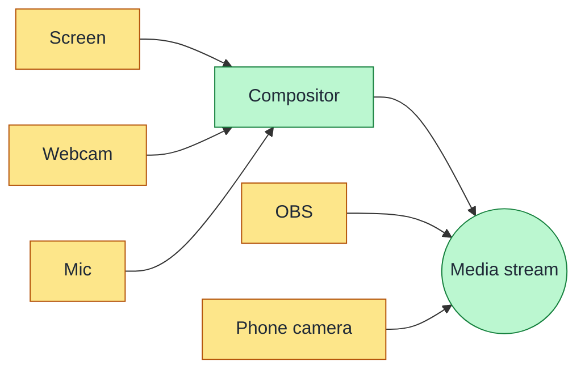
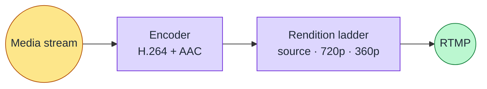
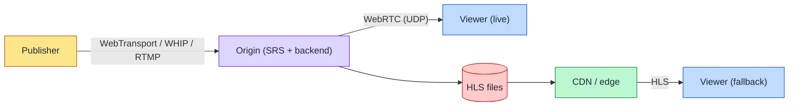
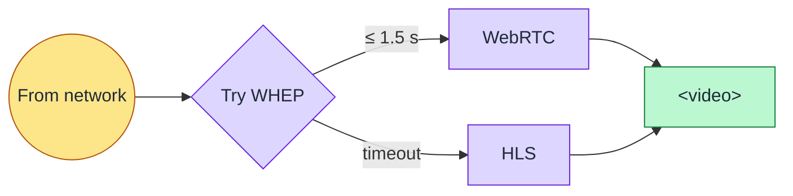

# Slide Diagrams — Capture / Encode / Transport / Display

Four high-level diagrams, one per slide. Each shows where data goes,
not how it's implemented.

---

## Slide 1 — Capture

---

## Slide 2 — Encode

---

## Slide 3 — Transport

---

## Slide 4 — Display

